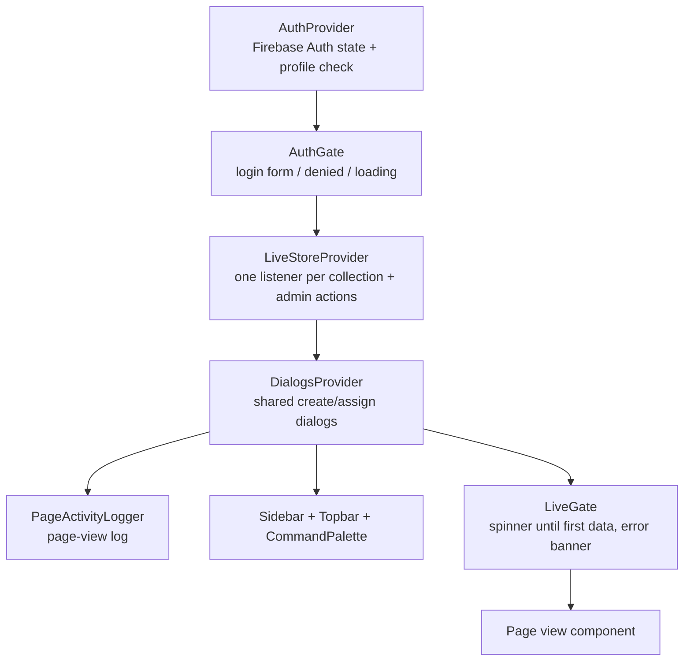

# Site Tracker Admin Dashboard — Documentation

> **Last verified:** 2026-11-04, against the working tree on branch `develop`
> (HEAD `857088f` **plus uncommitted Projects/inventory work**, see §14).
> **Scope:** this repo only (the Next.js web console). The phone app has its own
> `DOCUMENTATION.md` in the `Site-tracker` repo. The two share one Firebase
> project, so §12 ("Contract with the Android app") matters to both.
>
> **Keeping this file true:** see §16. Short version: any change to code, config,
> Firestore/RTDB schema, env vars, routes or UI behaviour should come with an
> edit here, and `PROJECT_CONTEXT.md` gets a changelog line.

---

## 1. What this is

A web console for the **Site Tracker** construction-crew app. Owners ("admins")
and the superadmin sign in and manage, live:

- **Sites and projects** (create, set status, assign crew), project stock allocation.
- **Crew** (invite by email, assign sites, deactivate, grant admin).
- **Live map** of where everyone last reported from.
- **Photos** (geotagged, per site/person) with permanent deletion.
- **Attendance** (check-in sessions → hours, timelines, CSV timesheet) with corrections.
- **Inventory** (what crew received at sites) and project-level stock.
- **Activity feed**, **audit log** and **page-view log** (superadmin).
- **Storage** meters, bulk **cleanup** and full **reset** (superadmin).

There is **no backend of its own**. The browser talks to Firebase directly
(rules enforce permissions). Only a handful of operations the browser cannot be
trusted with (deleting files, deleting login accounts, bulk wipes) go through
Next.js route handlers on the server.

## 2. Tech stack

| Concern | Choice |
|---|---|
| Framework | **Next.js 16.3.8** (App Router, React **19.2.8**, TypeScript 5). `AGENTS.md` warns this Next has breaking changes: read `node_modules/next/dist/docs/` before writing framework-level code. |
| Styling/UI | Tailwind CSS 4, shadcn (`base-nova` style, `@base-ui/react`), `lucide-react`, `motion` (animations), `sonner` (toasts), `cmdk` (command palette), `recharts` (charts), `react-day-picker`, `next-themes` (light/dark). |
| Fonts | Plus Jakarta Sans (same as the phone app) + Geist Mono. |
| Backend access (browser) | `firebase` v12: Auth, Firestore (with persistent IndexedDB cache), Realtime Database. |
| Backend access (server) | `firebase-admin` v14 (service account), `jose` (verifies Firebase ID tokens), Firestore **REST** with the caller's own token, Supabase Storage REST with the service-role key. |
| Maps | Google Maps JS API (advanced markers) when a key is set and accepted; **Leaflet + OpenStreetMap** as automatic fallback. |
| Photo files | Supabase Storage bucket `Photos` (public). Deletion/usage need the service-role key on the server. |
| Time zone | **Nepal Time, fixed UTC+5:45** for every date shown/bucketed (`src/lib/time.ts`). |
| Tests | `node --test` over two pure modules (`live.test.ts`, `reset.test.ts`) — 49 tests. |

## 3. Running it

```bash
npm install
npm run dev      # http://localhost:3000
npm run build && npm start   # needs a Node server, NOT a static export
npm run lint
npm test
npx tsc --noEmit
```

**Node version:** `npm test` runs `.ts` files directly, which needs Node's
TypeScript stripping — **Node ≥ 22.18 / 23.6+**. On Node 22.14 it fails with
`ERR_UNKNOWN_FILE_EXTENSION`; `node --experimental-strip-types --test
src/lib/live.test.ts src/lib/reset.test.ts` works (49/49 pass as of the verified date).

### Environment variables

Put them in `.env.local` (README) — a plain `.env` also loads. All are gitignored via `.env*`.
**Never print or commit values.**

| Variable | Used by | Required for |
|---|---|---|
| `NEXT_PUBLIC_FIREBASE_API_KEY`, `_AUTH_DOMAIN`, `_PROJECT_ID`, `_MESSAGING_SENDER_ID`, `_APP_ID`, `_DATABASE_URL` | browser + server (`firebase.ts`, `serverAuth.ts`) | everything (same project as the phone app). Without API key + project id the app shows the signed-out screen. |
| `NEXT_PUBLIC_GOOGLE_MAPS_API_KEY` | `GoogleCrewMap`, `googleMaps.ts` | Google map (else Leaflet fallback) |
| `NEXT_PUBLIC_GOOGLE_MAP_ID` | `GoogleCrewMap` | optional; defaults to Google's `DEMO_MAP_ID` |
| `NEXT_PUBLIC_SUPABASE_URL` | `storage.ts`, `next.config.ts` image host | photo file paths/usage/deletion |
| `SUPABASE_SERVICE_ROLE_KEY` (**server only, no `NEXT_PUBLIC_`**) | all `/api/*` routes | photo delete, usage meter, cleanup, reset, people/site delete |
| `FIREBASE_ADMIN_PROJECT_ID`, `FIREBASE_ADMIN_CLIENT_EMAIL`, `FIREBASE_ADMIN_PRIVATE_KEY` (**server only**) | `firebaseAdmin.ts` | deleting login accounts / sites / reset of people. Private key goes on one line with literal `\n`. |

> ⚠️ At the time of writing the local `.env` has the Firebase web, Google Maps,
> Supabase URL and service-role entries but **no `FIREBASE_ADMIN_*`**, so
> `/api/people/delete`, `/api/sites/delete` and the reset's people step answer
> HTTP 500 ("Deleting accounts isn't set up on the server…") until they are added.
> `README.md` does not list the Google Maps, Supabase URL or `FIREBASE_ADMIN_*` variables — see §15.

## 4. Architecture

### 4.1 Provider tree (every dashboard page)

`src/app/layout.tsx` → theme, tooltips, toaster. Pages under `src/app/(dashboard)`
render inside `AppShell`:



Pages (`page.tsx`) are tiny: they set metadata and render a **View** from
`src/components/views/`. Views read everything from `useLiveStore()`.

### 4.2 Data flow

```mermaid
flowchart LR
    Phone["Android app"] -->|writes| FS[("Firestore")]
    Phone -->|positions| RT[("Realtime DB")]
    Phone -->|files| SB[("Supabase Storage")]
    FS -->|onSnapshot| Store["LiveStore (src/lib/store.tsx)"]
    RT -->|onValue| Store
    Store -->|derive: live.ts / insights.ts| Views
    Views -->|admin.ts actions via attempt()| FS
    Views -->|fetch + Bearer ID token| API["/api/* route handlers"]
    API -->|service role / Admin SDK| SB
    API -->|Admin SDK / REST with caller token| FS
```

- **Reads are live and client-side.** `LiveStoreProvider` subscribes once per
  collection (list in §6) after the owner is verified, derives crew status and
  settled sessions, and refreshes a `now` tick every 30 s so statuses go stale
  correctly with no new data.
- **Writes** are functions in `src/lib/admin.ts`; each is wrapped by
  `attempt(label, work, audit)` (in `store.tsx`) which toasts failures and writes
  the audit line (§9).
- **Server routes** exist only where a browser can't be trusted. Each verifies the
  caller's Firebase ID token and role *before touching anything* (§8).
- **Browser cache:** Firestore uses `persistentLocalCache` (IndexedDB, multi-tab) so a
  reload is billed as only the changes. It is wiped on sign-out (`clearSavedData`).
  The sessions query cutoff is rounded to the start of the day so the cached query
  text stays identical all day and can resume.

### 4.3 Folder map

```
src/
  app/
    layout.tsx, globals.css        Root layout, theme tokens (Tailwind 4)
    (dashboard)/                   All pages (see §7) + layout.tsx → AppShell, template.tsx (entrance animation)
    api/                           Server route handlers (see §8)
  components/
    auth/        AuthProvider (auth state, signIn/signOut), AuthGate (login/denied UI)
    layout/      AppShell, Sidebar, Topbar, CommandPalette (Ctrl/⌘K), nav.ts (NAV_ITEMS), DialogsProvider,
                 LiveGate, PageActivityLogger, StorageMeter, ThemeProvider/Toggle
    views/       One big component per page (Overview, LiveMap, Sites, SiteDetail, Projects, ProjectDetail,
                 Crew, CrewProfile, Photos, Attendance, Inventory, Activity, Admins, AuditLog, Storage, Settings)
    domain/      App-specific pieces: dialogs (AddCrew, CreateSite, InventoryEntry, SessionEdit, Assign…),
                 Lightbox/PhotoThumb, maps (GoogleCrewMap, LeafletCrewMap, crewMapShared), PresenceBar/Timeline,
                 StorageUsage/Cleanup panels, reset/ (Reset all data wizard)
    charts/      Recharts wrappers (AttendanceTrend, BarCompare) + Sparkline (plain SVG)
    ui/          shadcn primitives (generated; edit sparingly)
    motion.tsx   Shared easing/animation helpers
  lib/           Logic — see §5, §6, §9 (most files are pure and unit-testable)
  types/domain.ts  Dashboard domain model (mirrors the app's Firebase documents)
public/          Default Next assets (unused by the product)
```

### 4.4 Code conventions seen in the repo

- `lib/live.ts`, `lib/reset.ts`, `lib/cleanup.ts`, `lib/usage.ts`, `lib/photoFiles.ts` use **relative imports with `.ts`
  extensions** so `node --test` can load them. Keep them free of `@/` aliases and framework imports.
- **Pure logic in `lib/`, thin views.** Derivations (hours, late arrivals, "needs attention") live in `insights.ts`.
- `// ponytail:` comments mark **deliberate shortcuts** with the upgrade path (found in `live.ts`, `prefs.ts`, `store.tsx`).
- 🚨 comments mark destructive-path invariants, notably the photo-deletion rule (§10).
- Dates always go through `lib/format.ts` / `lib/time.ts` (Nepal time). Don't call `toLocale…` directly.

## 5. Auth and roles

| `people/{uid}.appRole` | In the dashboard |
|---|---|
| `worker` | Denied: "This account isn't an admin." |
| `owner` ("Admin" in the UI) | Full dashboard, minus superadmin-only items |
| `superadmin` | Everything, plus: Admins page, Audit log, granting/revoking admin, deleting people/sites, Storage cleanup, Reset all data, page-view log |

`AuthProvider` signs in with email/password, then reads `people/{uid}` and
refuses: no profile, `active === false`, or role not owner/superadmin. This mirrors
the Firestore rules (`isOwner()`), it is a UX check — **rules are the real gate**.
Sign-in and sign-out are written to the audit log (`kind: "auth"`); signing out
flushes pending page views, clears the IndexedDB copy and reloads.
Nobody can become superadmin through the app; it is set by hand in the console/seed script.

## 6. Data model (what the dashboard reads and writes)

Same Firebase project as the phone app. Shapes in `src/types/domain.ts`.

| Store / collection | Dashboard reads | Dashboard writes | Notes |
|---|---|---|---|
| Firestore `people` | all docs, live | owner: `siteIds`, `active`, `role`, `email`, `phone`, `team`, `invitedAt`; superadmin: `appRole` only | Created by the person (invite flow uses a 2nd Firebase app). Deleted only via Admin SDK. |
| RTDB `positions/{uid}` | all, live | never (Admin SDK clears `siteId` on site delete) | `lat,lng,accuracy,kind,battery,paused,siteId,lastFixAt`. Indexed on `siteId`. |
| Firestore `sites` | all except legacy id `default` | create, `status`, `projectId` | `{name, code, status, manager, color, projectId?, startedAt, createdAt}` |
| Firestore `projects` | all | create | `{name, code, status, manager, color, startedAt, createdAt}` ⚠️ see §14 |
| Firestore `sessions` | last **15 days** (`start >= dayStart − 15d`, newest first) | owner correction (`start,end,endReason,siteId,editedAt`) | Written by the phone at check-in/out/pause/resume. |
| Firestore `photos` | newest **300** | **delete only** (through `/api/photos/delete`) | Files in Supabase: original + `_thumb.jpg`. |
| Firestore `deletedPhotos` | – | server writes a tombstone before deleting a record | So phones remove their local copy. |
| Firestore `events` | newest **300** | appends ("Site created", "Invite sent", "deactivated"…) | Same shape the phone writes: `{text, kind, type, personId, siteId, at}`. |
| Firestore `inventory` | newest **2000** | owner add / edit / delete | Crew-logged deliveries ("legacy" in the UI now). |
| Firestore `projectInventory`, `siteInventory`, `inventoryUsage` | all / all / newest 2000 | transactional add / allocate / record usage | ⚠️ new, see §14 |
| Firestore `adminAudit` | superadmin only, newest **500** | every admin action | Append-only. |
| Firestore `adminViews` | superadmin only, newest **1000**, only while the tab is open | page views (batched) | High volume, deletable by superadmin. |
| Supabase `Photos` bucket | image URLs (public) | server only | Layout `{personId}/{photoId}.jpg` and `…_thumb.jpg`. |

Not used by the dashboard: `pushTokens`.

### 6.1 Derived values (`src/lib/live.ts`) — read this first

| Constant | Value | Meaning |
|---|---|---|
| `SIGNAL_LOST_AFTER_MS` | 15 min | Checked-in phone silent this long is no longer "online". |
| `STALE_AFTER_MS` | 3 min | Marker activity (`kind`) turns `stale` (same as the phone app). |
| `ABANDONED_SESSION_MS` | 12 h | Cap on a never-closed session; also treats silent phones as not on shift. |

**Presence status** (`deriveCrew`), in priority order: `deactivated` (active=false) → `invited` (has `invitedAt`, never sent a fix)
→ `online` (checked in at a site, not paused, fix ≤15 min old) → `idle` (checked in but paused/silent) → `offline`.
`checkedIn` = position has a `siteId` and the last fix isn't older than 12 h.

**`settleSessions`** closes sessions the phone never closed (dead phone) with `endReason: "timeout"`: at the person's last
fix if they have been silent >15 min, or ≤12 h after start / at the next session's start. **These end times are
estimates**, computed in memory and never stored. Hours (`insights.workedMs`) merge one person's overlapping spans so a
duplicate check-in can't double count; shifts under 1 min don't count; a day >12 h is flagged for correction; arriving after
09:15 Nepal time counts as late.

Other mappers: `toSite`, `toProject`, `toPhoto` (defaults 1600×1200 when size is missing, thumb falls back to original),
`toEvent` (guesses `kind` from the text for old events without a `type`).

`roster` = `crew` filtered to `appRole === "worker"` — every headcount uses it; `crew` includes admins (for names/lookups).

## 7. Pages

Navigation lives in `components/layout/nav.ts`. Page files are in `src/app/(dashboard)/`.

| Route | View | What it does | Who |
|---|---|---|---|
| `/` | `OverviewView` | Today at a glance: online, hours & photos (today/week), attendance trend, "needs attention", per-site headcount, latest photos, live activity | admin |
| `/map` | `LiveMapView` | Last position of every person; filter by site/status; Google or Leaflet map | admin |
| `/sites`, `/sites/[id]` | `SitesView`, `SiteDetailView` | Site cards; detail has assigned crew (assign sheet), photos, activity, status change, crew map | admin; **delete site: superadmin** |
| `/projects`, `/projects/[id]` | `ProjectsView`, `ProjectDetailView` | **Uncommitted.** Create project; add project stock, allocate to site, record usage (with proof photos), usage history | admin |
| `/crew`, `/crew/[id]` | `CrewView`, `CrewProfileView` | Roster, invite (creates account + emails set-password link), deactivate/reactivate, assign sites; profile with 7-day online/offline timeline, last location | admin; **role change & delete person: superadmin** |
| `/photos` | `PhotosView` | Geotagged gallery filtered by site/person/date/type; thumbnails first, original in lightbox; multi-select delete | admin |
| `/inventory` | `InventoryView` | Crew-logged deliveries per site, totals, add/edit/delete ("Legacy inventory records" section) | admin |
| `/attendance` | `AttendanceView` | Crew × day grid, per-day timeline, edit a session (note → audit log), **timesheet CSV** (logged as an export) | admin |
| `/activity` | `ActivityView` | Event history by type/site | admin |
| `/admins` | `AdminsView` | Who has admin access; grant/revoke | **superadmin** |
| `/audit` | `AuditLogView` | Every admin edit, sign-in, export and failed/refused action | **superadmin** |
| `/storage` | `StorageView` | Firestore (estimated) / RTDB / photo-file usage vs free-tier limits; **Clean up**; **Reset all data** | admin sees meters; cleanup+reset superadmin |
| `/settings` | `SettingsView` | Account, per-browser prefs (default site, browser notifications for signal-lost / low battery while the tab is open), theme | admin |

Extras: **Command palette** (Ctrl/⌘K: jump to page/person/site or start a create flow), sidebar **storage meter**
(re-reads at most hourly), collapsible sidebar (remembered per browser), dark/light theme.

A site has a name, code, status, manager, colour and (new) project. **No location** — locations come from phones.

## 8. Server routes (`src/app/api/*`)

All are `POST` (usage is `GET`), JSON, `Authorization: Bearer <Firebase ID token>`. They verify the token against Google's JWKS
(`jose`), read `people/{uid}` **with that token** (so rules apply) and check `active` + role *before* anything else
(`serverAuth.ts`). Errors are `{ error }` with the HTTP status.

| Route | Role | Does |
|---|---|---|
| `/api/photos/delete` | owner | ≤200 ids. For each: delete original + thumbnail from Supabase, write `deletedPhotos` tombstone, delete record last. Returns `{deleted, failed[]}` per photo. Paths come from the stored record, never the request. |
| `/api/usage` | owner | Sums the bucket's real size (lists one folder level per person). |
| `/api/cleanup` | superadmin | `kind: photos` (older than 30, 90, 180 or 365 days — `AGE_CHOICES`, default 90) or `orphans` (files with no record, at least 1 h old); `mode: preview` reads only, `run` deletes a batch of 100 and re-previews so the UI loops until empty. Needs typed confirm word in the UI. |
| `/api/reset/preview`, `/api/reset/run` | superadmin | "Reset all data": step-by-step (`photos, people, sites, bulk, positions, notes, files`); bulk = sessions, inventory, events, views, audit. Admin/superadmin accounts are never deleted. Audit goes last so it records the reset. |
| `/api/people/delete` | superadmin | Deletes login (Admin SDK), their photos (files+record), position, push token, profile. History (sessions, inventory, events) stays. Refuses self / other superadmin. Idempotent. |
| `/api/sites/delete` | superadmin | Deletes site with its photos, inventory, sessions, events; removes it from every person's `siteIds`; clears RTDB `siteId`. Idempotent. |

Photo deletes run **as the caller** (their ID token) so Firestore rules still apply; the Admin SDK is only used where rules
forbid a browser (accounts, bulk).

## 9. Admin actions and the audit trail

`src/lib/admin.ts` (one function per action) → called from views through `attempt()`:

- `createProject`, `createSite`, `setSiteStatus`, `setSiteProject`, `setSiteCrew`, `setPersonSites`
- `addProjectStock`, `allocateProjectStock` (Firestore **transaction**: can't allocate more than free), `recordInventoryUsage`
  (transaction updating allocation + project roll-up + append-only `inventoryUsage` record: no overdraw)
- `inviteCrew` (see below), `resendInvite`, `setCrewActive`, `setAppRole`
- `updateSession`, `addInventoryEntry`, `updateInventoryEntry`, `deleteInventoryEntry`
- `deletePhotos`, `deletePerson`, `deleteSite` (call the server routes)

**`inviteCrew`:** a *second* Firebase app instance creates the Auth user with a random 20-char throwaway password and lets
that new user write their own `people/{uid}` as `worker` (the only create the rules allow). The admin's own session is untouched.
Then the admin sets `siteIds/email/phone/team/invitedAt`, sends the password-reset email, logs an event, and (superadmin
only, last, separately) sets `appRole: owner`. *Known limit:* if the profile write fails after the Auth user exists, the email
stays registered with no profile — remove it in the Firebase console.

**`attempt(label, work, audit)`** → on success writes an `adminAudit` line (`kind: "change"`, with before→after text from
`auditLog.describeFields`); on failure toasts and writes a `kind: "failed"` line with the reason (`Refused:` prefix when it
was a permission rejection). `logAction()` records non-write actions (CSV export). Audit writes never throw/block.
Rules cap fields: action ≤300, note ≤500, changes ≤1000, reason ≤300, only whitelisted keys.

**Page views** (`viewLog.ts` + `PageActivityLogger`): one tiny `adminViews` doc per page opened or external link followed;
repeats within 5 min dropped, ≤120/hour per tab (state kept in `sessionStorage`), flushed every 10 s in batches of 50 and on tab hide.

> Convention: who edited a session/inventory entry and why goes **only** to the superadmin-only `adminAudit` — the edited
> document just gets `editedAt` (every owner can read those documents).

## 10. Safety invariants (do not break)

1. **A photo is two files + one record.** Whatever deletes a photo must delete the original, the `_thumb.jpg` *and* the Firestore
   record — files first, record last — via `deletePhotoCompletely` (`photoServer.ts`). Deleting only one leaves a broken image or an
   orphan. Full checklist: `docs/READ-BEFORE-BUILDING-PHOTO-DELETION.md` in the **app repo**. If photo storage moves (Cloudflare R2 is
   being considered), only `storage.ts` and `photoFiles.ts` should need to change.
2. **Never import `firebaseAdmin.ts` or use `SUPABASE_SERVICE_ROLE_KEY` in client code.** Only routes that already ran
   `requireOwner`/`requireSuperadmin` may use them.
3. **Destructive routes are idempotent and ordered** so a retry finishes a half-done job.
4. **Cleanup/reset require previews and typed confirmation**; ages are limited to the offered list, never free-typed.
5. **Rules are the authority.** UI checks are for clarity; any new collection/field needs a matching block in the app repo's
   `firestore.rules`, deployed (§12).

## 11. UI notes

- Cards = `Panel`; page title = `PageHeader`; empty states = `EmptyState` (`domain/Panel.tsx`).
- Forms: `Field`, `TextInput`, `ChoiceChip` (`domain/FormBits.tsx`). Destructive confirms: `DeleteRecordDialog` (type the name),
  `DeletePhotosDialog`, reset/cleanup typed word.
- Each person has a `color` (same as the phone's map marker) → `PersonAvatar`; status dots pulse when online.
- Dialogs for "create site / add crew / assign" are mounted once in `DialogsProvider` and opened from several places (including
  the command palette).
- Charts: `AttendanceTrend` (hours bars + crew line, two axes), `BarCompare`, `Sparkline`.

## 12. Contract with the Android app (shared Firebase project)

The dashboard and phone only talk through Firebase. Things that must stay in sync:

| Item | Dashboard side | Phone side |
|---|---|---|
| `firestore.rules`, `database.rules.json`, `firestore.indexes.json` | **live in the app repo**; deploy with `firebase deploy --only firestore:rules,firestore:indexes,database` | same |
| `people` fields `siteIds,email,phone,team,invitedAt,active,role,appRole,avatar` | writes the owner-only ones | reads/limited self-edit (`name`,`avatar`) |
| `sessions` `{personId,siteId,start,end?,endReason}` | reads + admin correction | writes at check-in/out/pause/resume |
| RTDB `positions/{uid}.siteId` | reads, clears on site delete | writes while checked in |
| `photos` fields (`uri,thumbUrl,width,height,siteId,personId,personName,task,note,inventoryId,mediaType,…`) | reads, deletes | writes |
| `deletedPhotos/{id}` `{personId,takenAt,deletedAt}` | writes tombstone | reads at start/foreground, deletes local copy |
| `events` `{text,kind,type,personId,siteId,at}` | reads, appends | writes |
| `inventory` entries | edits/deletes (stamps `editedAt`) | creates; creator may log `usage` |
| Time zone / low battery 20% / GPS "good" ≤20 m | `LOW_BATTERY`, `GOOD_ACCURACY_M` | `BATTERY.lowLevel`, `GEOTAG_ACCURACY.goodMeters` |

Any schema change is a **two-repo change**: update both `DOCUMENTATION.md` files.

## 13. Tests and health (2026-11-04)

- `npx tsc --noEmit`: clean.
- `node --experimental-strip-types --test …`: 49/49 pass (`live.test.ts`: derivations, sessions, mappers; `reset.test.ts`: selection rules).
- `npm test` fails on Node 22.14 (needs ≥22.18). `npm run lint` and `npm run build` were not run for this document.
- Not covered by tests: all React components, server routes, `admin.ts` transactions, `insights.ts`, `cleanup.ts`, `usage.ts`.

## 14. Current state, gaps and risks

1. **Uncommitted work in progress** (git: 9 modified + 4 new files): Projects (`/projects`, `ProjectsView`, `ProjectDetailView`,
   `lib/projectInventory.ts`), project/site stock allocation and usage, `projectId` on sites, `Project`/stock types, new nav item.
2. 🚨 **Missing Firestore rules for the new collections.** The `firestore.rules` on the app repo's `origin/main` (2026-10-28)
   contains **no rules** for `projects`, `projectInventory`, `siteInventory` or `inventoryUsage`, so default-deny applies.
   `LiveStoreProvider` marks the store `ready` only after `projects` arrives, so if the rules aren't deployed the dashboard
   shows the permission-error banner and **never renders any page**. Verify what is deployed in the Firebase console, then add
   and deploy rules (owner-write, and a crew-read/limited-write design for the phone if crew will use allocations).
3. **Phone app doesn't use the new inventory model yet.** The app still writes the per-entry `inventory` collection; the new
   `projectInventory → siteInventory → inventoryUsage` flow exists only in the dashboard. The Inventory page labels the old data "Legacy".
4. **Environment:** `FIREBASE_ADMIN_*` missing locally (§3). README out of date (§15).
5. **Limits by design:** newest 300 photos / 300 events / 2000 inventory entries / 15 days of sessions are loaded; older data
   isn't shown. Abandoned-session end times are estimates (`ponytail`). Preferences are per-browser (`ponytail`).
   Photos taken before the app recorded a site show under "No site". Alert rules, shift hours, photo retention aren't built
   (nothing would send them without a scheduled job). Hosting must run a Node server.
6. Firestore size on the Storage page is an **estimate**; the Firebase console's Usage tab is exact.
7. Security hygiene seen in the app repo (affects this project): the Supabase bucket is public and not per-user isolated; a
   fixed-password seed admin (`admin@admin.com`) is committed in the app repo's seed script — change before real use.

## 15. Doc drift to fix when convenient

- `README.md` still says the map is OpenStreetMap "no key" (now Google with Leaflet fallback), lists 7 pages (the sidebar has 13 items),
  and omits Projects, Inventory, Storage, Admins, Audit, Settings, superadmin tools and several env vars. It also references
  `.env.local` only and the old `npm test` expectation.
- `AGENTS.md`/`CLAUDE.md` are the Next.js agent notice (auto-managed block) plus a pointer to this documentation.

## 16. Documentation maintenance protocol

Update **this file** and add a line to the changelog in `PROJECT_CONTEXT.md` whenever you change:

| If you change… | Update |
|---|---|
| a route / page / nav item | §7 (and §4.3 if a folder is new) |
| a server route, its role check or env var | §8, §3 |
| a Firestore/RTDB/Supabase field or collection, or a query limit | §6, §12 (+ the app repo's docs and `firestore.rules`) |
| status/hours logic or constants in `live.ts`/`insights.ts` | §6.1 |
| an admin action or what gets audited | §9 |
| a safety rule or destructive path | §10 |
| stack/versions/scripts | §2, §3 |
| a bug fixed or limit found | §13, §14 |

The AI assistant working in this repo is instructed (see `AGENTS.md` and `PROJECT_CONTEXT.md`) to end any reply that changed
behaviour with a one-line reminder to do this.
